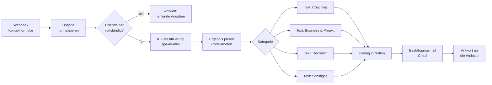

# Kontaktanfragen automatisch einordnen (n8n + KI)

Ein n8n-Workflow, der Anfragen aus einem Website-Kontaktformular entgegennimmt, mit einem Sprachmodell einer von vier Kategorien zuordnet, sie in einer Notion-Datenbank ablegt und eine passende Bestätigungsmail verschickt.

Gebaut als eigenes Projekt während meiner Weiterbildung zur KI-Managerin (IHK), 2026. Der Workflow lief auf einer n8n-Instanz der Weiterbildung und wurde dort mit Testanfragen geprüft. Die Instanz ist inzwischen abgeschaltet, deshalb liegt er hier als Export zum Nachbauen.

## Das Problem

Über ein Kontaktformular kommen sehr unterschiedliche Anfragen: Privatpersonen, Unternehmen, Recruiter, gelegentlich Unklares. Von Hand heißt das: jede Mail lesen, einordnen, irgendwo notieren und eine Eingangsbestätigung schreiben. Das kostet Zeit und geht bei vielen Anfragen schnell unter.

## Ablauf



14 Knoten, ohne Zugangsdaten exportiert: [`workflow/kontaktanfragen-klassifizierung.json`](workflow/kontaktanfragen-klassifizierung.json)

## Designentscheidungen

- **Erst prüfen, dann KI.** Fehlen E-Mail-Adresse oder Nachricht, antwortet der Workflow sofort mit einer Fehlermeldung. Das Modell wird dann gar nicht aufgerufen, das spart Kosten und unnötige Einträge.
- **Feste Antwortform.** Das Modell darf nur ein JSON-Objekt mit `kategorie`, `konfidenz` und `begruendung` zurückgeben. Ein Code-Knoten liest es aus und prüft, ob die Kategorie eine der vier erlaubten ist.
- **Sicher scheitern.** Liefert das Modell keine gültige Kategorie, landet die Anfrage unter „Sonstiges“ und wird zur manuellen Prüfung markiert. Es geht keine Anfrage verloren.
- **Mensch behält das letzte Wort.** Liegt die Konfidenz unter 0,55, setzt der Workflow in Notion das Häkchen „Manuell prüfen“. Die Begründung des Modells steht im Eintrag, damit die Einordnung nachvollziehbar bleibt.
- **Alles an einem Ort.** Name, Nachricht, Kategorie, Konfidenz, Begründung, Quelle und Eingangszeit landen strukturiert in Notion und lassen sich dort filtern.

## Testen

In [`beispiel-anfragen.json`](beispiel-anfragen.json) liegen vier erfundene Anfragen mit dem jeweils erwarteten Ergebnis, darunter ein Fall ohne E-Mail-Adresse. Ein Aufruf zum Testen:

```bash
curl -X POST https://<deine-n8n-domain>/webhook-test/kontaktanfrage-website \
  -H "Content-Type: application/json" \
  -d '{"name":"Erika Beispiel","email":"erika.beispiel@example.com","nachricht":"Ich betreue als Personalberaterin eine Position als Business Analyst."}'
```

## Selbst einrichten

1. In n8n: **Workflows → Import from File** und die JSON-Datei wählen.
2. Zugangsdaten verbinden: OpenAI (Knoten „Message a model“), Notion („Eintrag in Notion erstellen“), Gmail („Bestätigungsmail senden“).
3. Im Notion-Knoten `DEINE_NOTION_DATENBANK_ID` durch die eigene Datenbank ersetzen. Die Datenbank braucht diese Spalten: Name (Titel), E-Mail, Nachricht, Kategorie (Auswahl), Status (Auswahl), Konfidenz (Zahl), Begründung, Manuell prüfen (Checkbox), Quelle, Eingegangen am (Datum).
4. Kategorien, Prompt und Mailtexte an das eigene Angebot anpassen.
5. Mit den Beispielanfragen testen, dann aktivieren.

## Grenzen

- Die Konfidenz ist eine Selbsteinschätzung des Modells, keine gemessene Trefferquote. Deshalb die Schwelle für die manuelle Prüfung und die sichtbare Begründung.
- Die Anfragen gehen an einen externen KI-Dienst. Für den produktiven Einsatz gehören ein Hinweis in die Datenschutzerklärung und eine Prüfung, welche Daten an das Modell gehen.
- Kein Spam-Schutz im Workflow selbst. Der gehört ins Formular, zum Beispiel ein Honeypot-Feld oder ein Captcha.
- Getestet mit Einzelanfragen, nicht unter Last.

## Werkzeuge

n8n · OpenAI (gpt-4o-mini) · Notion · Gmail · JavaScript im Code-Knoten
